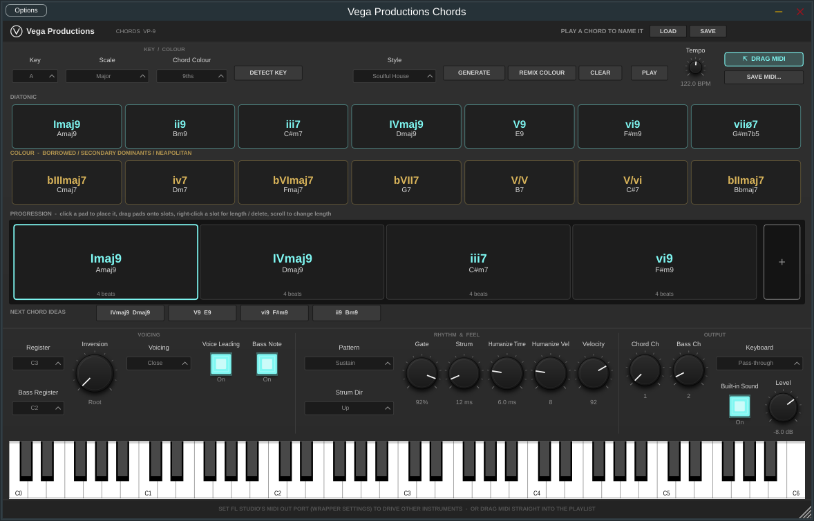

# Vega Productions Chords (VP-9)

A chord-progression instrument for the Vega Productions suite. Build progressions from Roman-numeral chord pads, voice them like a keys player, groove them with house/neo-soul rhythms, and send MIDI to any instrument — or drag the whole progression straight into FL Studio as a MIDI clip.



## Download
- **Windows (FL Studio):** https://github.com/DJVega70/vega-chords/releases/latest/download/VegaProductions-Chords-Windows-VST3.zip
- **macOS (Ableton / Logic):** https://github.com/DJVega70/vega-chords/releases/latest/download/VegaProductions-Chords-macOS-VST3-AU.zip

Copy `Vega Productions Chords.vst3` to `C:\Program Files\Common Files\VST3\` (Windows) or `~/Library/Audio/Plug-Ins/` (Mac, `.component` goes in `Components/`).

## Features
- **Smart harmony:** key + 8 scales, diatonic pads with Roman numerals, a second row of colour chords (borrowed iv / bVI / bVII / bIII, secondary dominants, Neapolitan), extension levels Triads → 7ths → 9ths → Neo-Soul, next-chord suggestions.
- **Generator & remix:** one-click progressions in Soulful House, Deep House, Neo-Soul, Pop, Jazz and Cinematic styles; Remix Colour swaps in borrowed/extended chords.
- **Voicings:** Close, Drop 2, Drop 3, Spread, Rootless, Shell; inversion control; automatic voice leading; separate bass note with its own register.
- **Rhythm & feel:** sustain, house offbeats, syncopated 3-3-2, stabs and arpeggio patterns; gate, strum (up/down/alternate), humanized timing and velocity.
- **Performance:** One-Finger mode (white keys = diatonic chords, black keys = colour chords); live chord naming of whatever you play; Detect Key from your playing.
- **MIDI out:** separate chord and bass channels, host-tempo sync, **drag-and-drop MIDI export** and Save MIDI.
- **Built-in electric piano** so you hear chords without routing anything; user chord-set presets (`Documents/Vega Productions/Chords Presets`).

## Using it in FL Studio
1. Load it on a Channel Rack slot. You'll hear the built-in piano right away.
2. To drive another synth: open the plugin's wrapper settings (gear icon) → **MIDI → Output port**, pick a number, then set the same **Input port** on the target synth (e.g. Vega Productions Multisynth). Turn *Built-in Sound* off if you only want the synth.
3. Or just grab **DRAG MIDI** and drop it in the Playlist or Piano roll.

In Ableton, put it on a MIDI track and set another MIDI track's input to that track ("Post FX").

## Building
```
cmake -B build -DVEGA_TESTS=ON
cmake --build build --config Release --target VegaChords_VST3 VegaChordsTest
```
